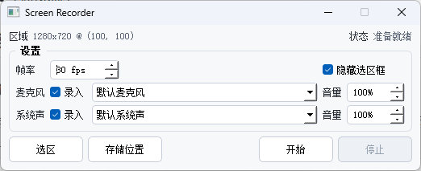

# Screen Recorder

一个 Windows 桌面录屏小工具，支持区域录制、麦克风、系统声音、音量调节和 MP4 输出。

## 功能

- 选择屏幕录制区域，并保留可拖动、可缩放的绿色选区框
- 录制屏幕画面和鼠标指针，输出 MP4
- 录制麦克风声音
- 录制系统播放声音，使用 Windows WASAPI Loopback
- 麦克风和系统声音可分别选择是否录入
- 麦克风和系统声音可分别调节音量
- 可设置录制帧率
- 录制开始后隐藏主窗口，只显示悬浮录制条和停止按钮
- 
- 可选择视频保存位置，文件名按时间自动生成


## 直接下载使用

如果你只是想使用，不想配置 Python 环境：

1. 打开 GitHub 仓库的 `dist`
2. 下载 `ScreenRecorder.zip`
3. 解压后进入 `ScreenRecorder` 文件夹
4. 双击 `ScreenRecorder.exe`

发布包已经包含运行所需依赖和 `ffmpeg.exe`，不需要安装 Python、Conda 或 FFmpeg。

## 从源码运行

### 1. 创建 Conda 环境

```powershell
conda create -n screen-recorder python=3.10 -y
conda activate screen-recorder
```

### 2. 安装依赖

```powershell
pip install -r requirements.txt
```

### 3. 准备 FFmpeg

下载 Windows static/essentials 版 FFmpeg，取其中的：

```text
bin/ffmpeg.exe
```

放到：

```text
screen_recorder/resources/ffmpeg.exe
```

推荐使用 static/essentials 版，不要使用 shared 版；shared 版会依赖大量 DLL，打包体积会明显变大。

### 4. 启动程序

```powershell
python -m screen_recorder.main
```

## 使用说明

1. 点击 `选区`，拖拽选择录制区域。
2. 绿色选区框出现后，可以拖动位置，也可以拖动边缘或角点调整大小。
3. 设置帧率、麦克风、系统声和音量。
4. 麦克风和系统声默认都会录入；取消对应的 `录入` 勾选框，则该路声音不会进入视频。
5. 点击 `存储位置` 选择输出目录。
6. 点击 `开始`，程序倒计时 3 秒后开始录制。
7. 录制开始后主窗口会隐藏，只显示悬浮录制条。
8. 点击悬浮录制条上的 `停止`，程序会保存 MP4 并恢复主窗口。

## 打包

项目提供 PyInstaller 打包脚本：

```powershell
.\build.ps1 -Clean
```

打包完成后会生成：

```text
dist/ScreenRecorder/ScreenRecorder.exe
```

分发时建议压缩整个文件夹：

```text
dist/ScreenRecorder
```

更多说明见 [PACKAGING.md](PACKAGING.md)。

## 项目结构

```text
screen_recorder/
  main.py
  ui/
    region_selector.py
  recorder/
    screen.py
    cursor.py
    audio.py
    encoder.py
  utils/
    config.py
  resources/
    ffmpeg.exe
```

## 技术栈

- Python 3.10
- PyQt5
- mss
- sounddevice
- PyAudioWPatch
- FFmpeg
- PyInstaller

## 常见问题

### 为什么不把 ffmpeg.exe 提交到 GitHub 仓库？

static 版 `ffmpeg.exe` 通常接近或超过 100MB，GitHub 普通仓库不适合直接提交这种二进制文件。建议源码仓库不包含 `ffmpeg.exe`，发布包通过 GitHub Releases 上传。

### 为什么系统声音没有录到？

系统声音请选择带 `Loopback` 的输出设备，例如：

```text
扬声器 (...) [Loopback] [Windows WASAPI Loopback]
```

如果仍然没有声音，请确认系统当前播放设备和程序里的系统声设备一致。

### 录制时弹出 ffmpeg 黑色窗口怎么办？

当前代码已经使用 Windows 无窗口方式启动 ffmpeg。请重新打包或运行最新代码。

## License

MIT License。

